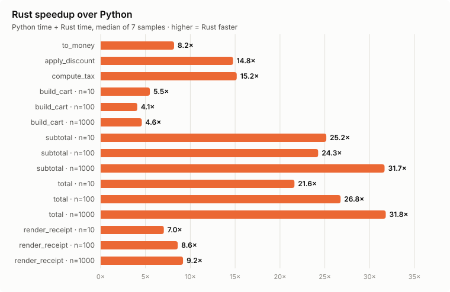
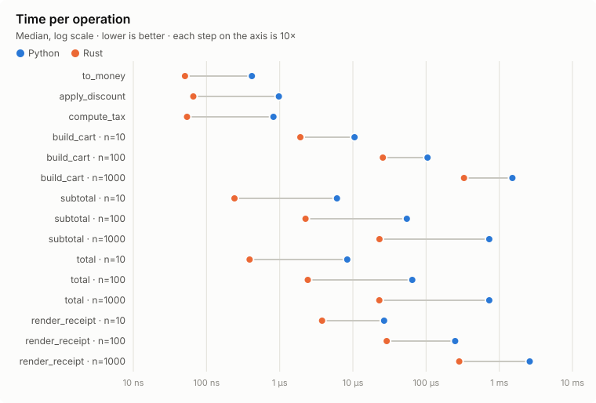

# Benchmarks: Python vs Rust

Both implementations run the same cases with the same method: each case is calibrated so one sample takes about 50 ms, 7 samples are taken, and the **median time per operation** is reported. Lower is better; *speedup* is Python time ÷ Rust time.

## Environment

- CPU: Intel(R) Core(TM) Ultra 7 155H
- OS: Linux 7.2.9-arch1-1
- Python: CPython 3.14.7
- Rust: rustc 1.99.0 (b940084d7 2026-09-28), bench profile (optimized)

## Results

| Case | n | Python | Rust | Speedup |
| --- | ---: | ---: | ---: | ---: |
| `to_money` | – | 416.6 ns | 50.9 ns | **8.2×** |
| `apply_discount` | – | 973.6 ns | 65.9 ns | **14.8×** |
| `compute_tax` | – | 821.7 ns | 54.2 ns | **15.2×** |
| `build_cart` | 10 | 10.52 µs | 1.92 µs | **5.5×** |
| `subtotal` | 10 | 6.07 µs | 241.0 ns | **25.2×** |
| `total` | 10 | 8.38 µs | 387.7 ns | **21.6×** |
| `render_receipt` | 10 | 26.69 µs | 3.79 µs | **7.0×** |
| `build_cart` | 100 | 104.64 µs | 25.64 µs | **4.1×** |
| `subtotal` | 100 | 54.64 µs | 2.25 µs | **24.3×** |
| `total` | 100 | 64.76 µs | 2.42 µs | **26.8×** |
| `render_receipt` | 100 | 249.27 µs | 28.99 µs | **8.6×** |
| `build_cart` | 1000 | 1.51 ms | 329.48 µs | **4.6×** |
| `subtotal` | 1000 | 730.22 µs | 23.06 µs | **31.7×** |
| `total` | 1000 | 730.28 µs | 22.97 µs | **31.8×** |
| `render_receipt` | 1000 | 2.61 ms | 283.83 µs | **9.2×** |





### Cases

- `to_money`: Parse `"1234.565"` and round to cents
- `apply_discount`: Apply `WELCOME10` to 100
- `compute_tax`: 19% `DE` tax on 100
- `build_cart`: Create a cart and add *n* distinct items
- `subtotal`: Sum all line totals
- `total`: Subtotal, discount and tax
- `render_receipt`: Render the full text receipt

## Summary

- Rust is faster in every case, from **4.1×** (`build_cart/100`) to **31.8×** (`total/1000`).
- The gap is largest for pure decimal arithmetic (`subtotal`, `total`) and smallest for cases dominated by string building and allocation (`build_cart`, `render_receipt`).
- Both implementations scale roughly linearly with the number of items: 10× more items costs Python 8–14×, Rust 6–13× more time.

## Reproducing

```bash
# from shopcart/
python bench/bench.py bench/results/python.json
(cd src-rs && cargo bench --bench compare -- "$PWD/../bench/results/rust.json")
python bench/compare.py bench/results/python.json bench/results/rust.json > BENCHMARKS.md
```

Results are from a single run on one machine; expect some variation between runs.
